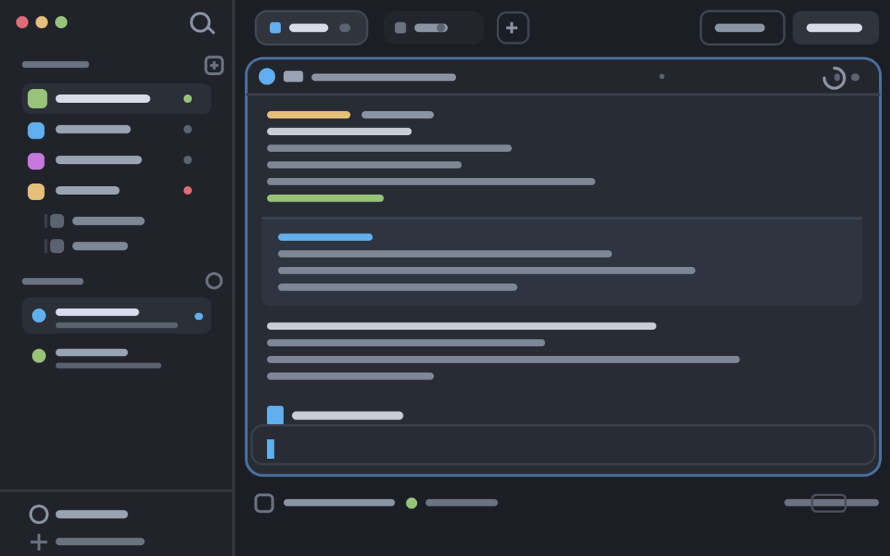

# Mayonaka

A dark, quiet layout for the [Herdr](https://herdr.dev) desktop app: a slim
sidebar with your spaces and agents, tab pills across the top, and terminals as
rounded cards. A panel on the right holds a file browser that opens files in an
editor pane beside the terminals, the shipped Changes panel, and a lane graph
of every branch.



`preview.png` is a drawing of the layout, not a screenshot.

## What you get

- **Files**: a lazy tree of the focused pane's folder with Material icons and
  one-letter git marks (`M` `A` `D` `U`). Right-click for open, reveal, copy
  path, rename, delete, new file or folder. Drag a row onto a folder to move
  it, or onto a terminal to type its path there.
- **Editor pane**: click a file to open it beside the terminals. Markdown opens
  as a rendered preview you can edit block by block; images open as a picture;
  everything else opens as source. `⌘S` saves.
- **Graph**: local branches, remote branches and tags as colored lanes. Click a
  commit for its message and changed files. It never writes to the repository.
- **Status bar**: the current agent's session, plus CPU load and used memory of
  the machine the shown space lives on.
- **Command palette**: `⌘⇧P` opens Herdr's palette with a Mayonaka group on
  top: toggle the Files, Changes and Graph panels, and save or switch preview
  when the tab shows one editor. With
  [terminal-browser](https://github.com/zenbu-labs/terminal-browser) installed
  it also opens that browser in a split to the right or in a new tab.
- **New tab menu**: the `+` in the tab bar lists Browser under Terminal when
  terminal-browser is installed, and opens it in a tab of its own.
- **Keys**: `⌘⌥B` toggles the Files panel, `⌘⇧P` opens the palette, `⌘S` saves
  in the editor, `⌘⇧V` switches the editor between preview and source.

[RECIPE.md](RECIPE.md) describes every region, size and behavior, and is the
brief to rebuild the layout from scratch.

## Install

Built on `herdr-app 0.1.14`; every mod passes `herdr-app check` on `0.1.15`. macOS only so far.

The short way: ask an agent running in Herdr to add the layout from this
repository. It follows the steps below.

By hand, with the app's home at `~/.config/herdr-app`:

1. Copy `layouts/mayonaka.json` and `layouts/mayonaka.svg` into `layouts/`.
2. Copy every folder under `mods/` into `mods/`. If a name is already taken,
   rename the new one and the places that refer to it rather than overwriting.
3. Merge `keys.json` into your own. Add its sections and keys; don't replace a
   key you already use.
4. Check each mod, then switch to the layout:

   ```sh
   for mod in ~/.config/herdr-app/mods/mayonaka-*; do herdr-app check "$mod"; done
   herdr-app do layout.switch --name mayonaka
   ```

Your own layout stays as it was: `ctrl-shift-l` switches back, and deleting the
copied files removes Mayonaka.

## Before you add it

These mods run programs and touch files, on the machine the pane lives on:

- `mayonaka-files` lists folders and runs `git status` through `sh` (PowerShell
  on Windows), and creates, renames, moves and deletes files when you ask it
  to. Delete goes to the Trash on macOS and is permanent elsewhere.
- `mayonaka-editor` writes the file you save, only where you run Herdr; remote
  panes are read-only.
- `mayonaka-gitgraph` runs read-only `git` commands.
- `mayonaka-status` runs `iostat`, `vm_stat` and `sysctl` on macOS, or reads
  `/proc` on Linux, every 5 seconds.

- `mayonaka-palette` and `mayonaka-new-menu` run `command -v terminal-browser`
  when they open. Choosing a browser entry starts terminal-browser, which is a
  Chromium browser with its
  own network access and, until you turn it off, usage telemetry
  (`terminal-browser config set telemetry.usage off`).

None of the mods reaches the network itself.

## Repository

| Path | What it is |
|---|---|
| `layouts/` | The layout tree and the small drawing Settings shows for it |
| `mods/` | The eleven mods the layout and its keys use |
| `keys.json` | The keys the mods expect |
| `RECIPE.md` | The full brief: what you see, how it behaves, what it is built from |
| `tools/material-icons.py` | Regenerates the file icons and their lookup table |

## Credits

File icons are from
[Material Icon Theme](https://github.com/material-extensions/vscode-material-icon-theme)
5.40.0, MIT licensed; the license is in `mods/mayonaka-files/material/LICENSE`.
