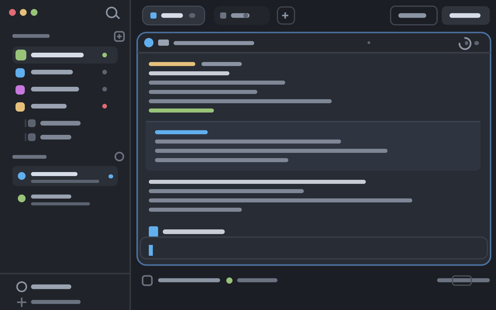

# Mayonaka

A dark, quiet layout for the [Herdr](https://herdr.dev) desktop app: a slim
sidebar with your spaces and agents, tab pills across the top, terminals and
native **Mizar** chat cards in the main workspace, and a right panel holding a
file browser, Changes list, and git lane graph.



`preview.png` is a drawing of the layout, not a screenshot.

## What you get

- **Files**: a lazy tree of the focused pane's folder with Material icons,
  open-file dots and one-letter git marks (`M` `A` `D` `U`), plus instant fuzzy
  search across the whole repository (`⌘⌥F`, `/`, `⌘F`, or just start typing in
  the tree; `.*` includes git-ignored files). Right-click for open, open to the
  right, open below, reveal in tree or Finder, copy path, rename, delete, new
  file or folder. Drag a row onto a folder to move it, or onto a terminal to
  type its path there.
- **File cards**: every opened file is its own rounded card pane beside the
  terminals — the first file splits to the right of the terminal, subsequent
  files tile automatically into a balanced vertical stack and `2×2` grid without
  squishing your terminal (`⌘`-click splits right, `⌥`-click splits below;
  clicking an already open file focuses its card instead of replacing anything).
  Each file card uses a single 30px header showing its Material icon, file name,
  parent path (`mods › …`), unsaved dot, preview/source toggle, and hover split /
  zoom / close controls. Markdown opens as a rendered preview you can edit block
  by block (over 256 KiB, as source first); images open as a picture; everything
  else opens as source. An edit saves itself shortly after your last keystroke
  (half a second up to 256 KiB, 1.5 s up to 2 MiB, 3 s past that), in a remote
  space on that machine; `⌘S` saves at once.
- **Graph**: local branches, remote branches and tags as colored lanes. Click a
  commit for its message and changed files. It never writes to the repository.
- **Mizar**: opens as a first-class workspace tab or split card (`⌘⌥M`, `+`
  menu, or command palette) and spawns its own headless `mizar rpc` process over
  authenticated `127.0.0.1` TCP (`auth.hello`). Renders Mizar's native
  minimalist chat view (`pi-emphasis` semantic pills, colored unified diffs,
  collapsible thinking/tool cards, `/` slash pickers, `@` file mention
  completion, `!`/`!!` local shell, inline approvals, subagent drilling, and
  1-line bottom status bar) with zero duplicate headers.
- **Status bar**: the current agent's session, plus CPU load and used memory of
  the machine the shown space lives on.
- **Command palette**: `⌘⇧P` opens Herdr's palette with a Mayonaka group on
  top: toggle the Files, Changes and Graph panels, open a new Mizar tab or split
  a Mizar card to the right, find a file in the Files
  panel, reopen a closed file, and save, switch preview, close the file card or
  turn auto save off and on when the tab has an editor card. With
  [terminal-browser](https://github.com/zenbu-labs/terminal-browser) installed
  it also opens that browser in a split to the right or in a new tab.
- **New tab menu**: the `+` in the tab bar lists **Mizar** right under Terminal
  (and Browser when terminal-browser is installed).
- **Keys**: `⌘⌥B` toggles the Files panel, `⌘⌥F` searches files, `⌘⌥M` opens a
  new Mizar tab, `⌘⇧P` opens the
  palette, `⌘⌥←/→/↑/↓` moves focus between terminal and file cards (`⌘⌥⇧←/→/↑/↓`
  swaps cards), and in an editor card `⌘S` saves, `⌘⇧V` switches between preview
  and source, `⌘W` closes the file card, and `⌘⇧T` reopens the last closed file.

[RECIPE.md](RECIPE.md) describes every region, size and behavior, and is the
brief to rebuild the layout from scratch.

## Install

Built on `herdr-app 0.1.14`; every mod passes `herdr-app check` on `0.1.15`. macOS only so far.

The short way: ask an agent running in Herdr to add the layout from this
repository. It follows the steps below.

By hand, with the app's home at `~/.config/herdr-app`:

1. Copy `layouts/mayonaka.json` and `layouts/mayonaka.svg` into `layouts/`.
2. Copy every folder under `mods/` into `mods/`. If a name is already taken,
   rename the new one and the places that refer to it rather than overwriting.
3. Merge `keys.json` into your own. Add its sections and keys; don't replace a
   key you already use.
4. Check each mod, then switch to the layout:

   ```sh
   for mod in ~/.config/herdr-app/mods/mayonaka-*; do herdr-app check "$mod"; done
   herdr-app do layout.switch --name mayonaka
   ```

Your own layout stays as it was: `ctrl-shift-l` switches back, and deleting the
copied files removes Mayonaka.

## Before you add it

These mods run programs and touch files, on the machine the pane lives on:

- `mayonaka-files` lists folders, indexes files for search (`git ls-files`,
  `rg --files` or `find`) and runs `git status` through `sh` (PowerShell on
  Windows), and creates, renames, moves and deletes files when you ask it to.
  Delete goes to the Trash on macOS and is permanent elsewhere.
- `mayonaka-editor` writes the file you edit: 0.5–3 seconds after your last
  keystroke (scaled by file size, until you turn auto save off in the palette)
  and when you press `⌘S`.
  It writes directly on this computer up to 1 MiB, and for larger files (up to
  8 MiB) or in a remote space with `hc file write` (`--on <machine>` when
  remote), which it runs through `sh` while the text waits for a moment in
  `cache/mayonaka-editor/save/` under the app's home. It reads the file first and
  refuses the save if it changed since it was opened.
- `mayonaka-gitgraph` runs read-only `git` commands.
- `mayonaka-mizar` spawns a local `mizar rpc` process (`~/.local/bin/mizar` or
  `mizar` on `PATH`), reads its `0600` loopback ready file, and connects
  strictly over `127.0.0.1` (`auth.hello`) to stream sessions, run local
  `!`/`!!` shell commands, fork branches, and resolve approvals. It never connects
  to external hosts.
- `mayonaka-status` runs `iostat`, `vm_stat` and `sysctl` on macOS, or reads
  `/proc` on Linux, every 5 seconds.

- `mayonaka-palette` and `mayonaka-new-menu` run `command -v terminal-browser`
  when they open. Choosing a browser entry starts terminal-browser, which is a
  Chromium browser with its
  own network access and, until you turn it off, usage telemetry
  (`terminal-browser config set telemetry.usage off`).

None of the mods reaches external networks itself (except `terminal-browser`
if launched, and `mayonaka-mizar` talking over `127.0.0.1` loopback TCP to local
Mizar processes).

## Repository

| Path | What it is |
|---|---|
| `layouts/` | The layout tree and the small drawing Settings shows for it |
| `mods/` | The twelve mods the layout and its keys use |
| `keys.json` | The keys the mods expect |
| `RECIPE.md` | The full brief: what you see, how it behaves, what it is built from |
| `tools/material-icons.py` | Regenerates the file icons and their lookup table |

## Credits

File icons are from
[Material Icon Theme](https://github.com/material-extensions/vscode-material-icon-theme)
5.40.0, MIT licensed; the license is in `mods/mayonaka-files/material/LICENSE`.
