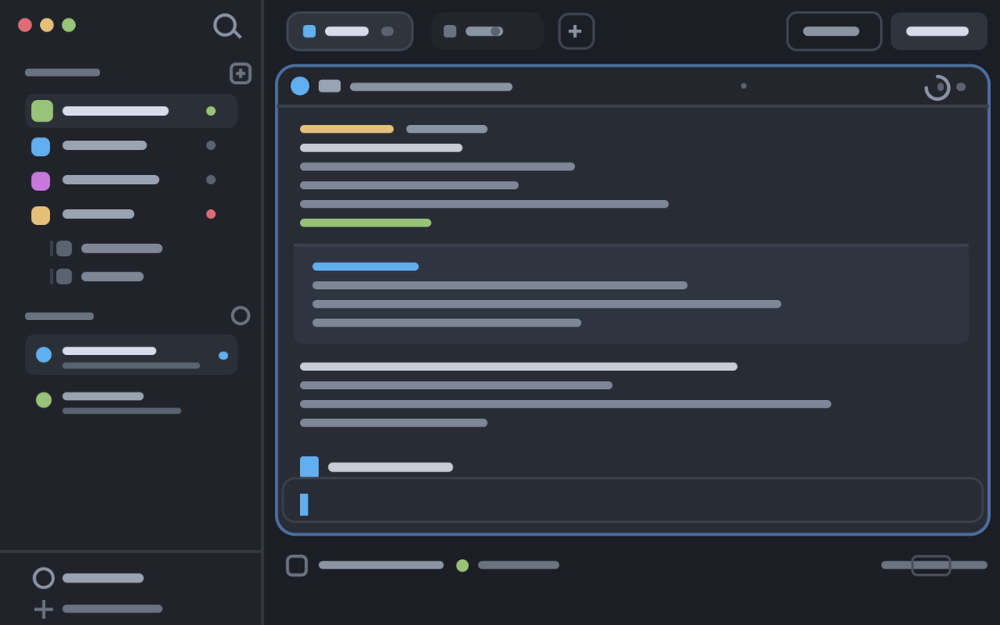

# Mayonaka

A dark, quiet Herdr workspace: a slim rail sidebar with your spaces and agents,
tab pills across the top, and terminals as rounded cards. A Files panel opens
on the right and edits files in a code pane beside the terminals; next to it,
Changes and a Graph of every branch.

## What you see

- **Sidebar, left, 268px** (`background: chrome`, never draggable): three stacked
  parts. A 46px rail with the macOS traffic lights on its left and a search button
  on its right; the spaces list and the agents list below it, sharing the height
  evenly, 90px minimum each; a 69px footer holding *Settings* (with a dot when an
  update is ready) and *Add machine*, separated by a 1px top border.
- **Tab bar, 42px** across the top of the work area: `mayonaka-tabs`, the shipped
  `tabs` with one more button — tab pills, a `+` menu, and the *Files* /
  *Changes* / *Graph* buttons on the right.
- **Main, the rest**: the shown tab's terminals, each as a card with a 10px radius,
  1px `border` (an `accent` border while focused), an 8px gap between panes, and a
  30px pane header that is always visible. Single-pane tabs are framed too.
  The area around the cards has 8px padding and an 8px gap.
- **Files panel, right, 368px** (`min` 280, `max` 900, closed until you open it):
  a stack of three panels, *Files* (`mayonaka-files`), *Changes* (the shipped
  `changes`) and *Graph* (`mayonaka-gitgraph`). *Files* lists the focused pane's folder in 28px rows — chevron,
  folder or file glyph, name, and a one-letter git mark (`M` `A` `D` `U`) — with a
  42px header showing the folder or the open file's name. *Graph* draws the
  repository's local branches, remote branches and tags as colored lanes in 24px
  rows — the graph, ref pills (`HEAD → main · origin`, `◆ tag`), the subject, the
  short SHA and the date — with an *Uncommitted Changes* row on top when the
  tree is dirty.
- **Status bar, bottom, 28px**: the shipped `workspace-status`.
- Look: 10px radius cards on a `canvas` background, terminal padding 14px vertical
  by 12px horizontal, no system title bar (the layout draws its own), macOS window
  buttons at `[12, 16]`. Type and colors come from `settings.json`, else Herdr's.

## How it behaves

- Agent and space status in the lists, tab pills and status bar is the shipped
  behaviour: working spins, blocked and done show a dot in `blocked` / `done`.
- **Search** in the rail opens the shipped `picker`. **Settings** opens
  `app.settings`; **Add machine** opens the `machine-add` dialog.
- **Files**: click a folder to expand it, click a file to open it in a
  `mayonaka-editor` pane split to the right (⌘-click always makes a new pane;
  a plain click retargets the editor pane already in this tab). A file with
  unsaved edits is never silently replaced — the first click warns in a toast,
  the second discards. Files refresh on a 10 second timer and on folder changes;
  the tree is capped at 500 entries per folder and 5,000 in total.
- **Right-click in Files** opens a menu: on a file *Open*, *Open with Default
  App*, *Reveal in Finder*, *Copy Path*, *Copy Relative Path*, *Rename…*,
  *Delete*; on a folder *New File…* and *New Folder…* in place of *Open*; on
  the empty area below the tree the same for the panel's folder plus
  *Refresh*. ↑/↓, Enter and Esc work in it. Rename
  selects the name without its extension; an existing name is refused. Delete asks
  first and moves to the Trash on macOS (`trash`, else Finder); on Linux, Windows
  and other machines it deletes permanently, and says so. A new file opens in the
  editor. Default app and Reveal are hidden in remote spaces.
- **Drag a file or folder** out of Files onto a terminal pane to type its path
  there (shell-quoted, with a trailing space, no Enter). A label follows the
  pointer and the target pane's header lights up in `accent`; Esc or a drop
  anywhere else cancels. It goes through the clipboard, which gets its text back
  right after.
- **Editor**: markdown opens as rendered preview, everything else as source;
  the eye / code buttons in its 34px header switch. The preview is editable one
  block at a time (a list one item at a time, nested items included), and stays
  rendered while you type: heading, quote, list and
  task markers show as a heading badge, quote bars, bullets, numbers and boxes;
  bold, italic, strikethrough, inline code, links and images show as such the
  moment their closing mark is typed. Click a mark to see and edit its markdown
  (it folds again once you type elsewhere), click a task box to tick it,
  Backspace after a marker turns the line back into text. Return in a list or
  quote starts the next item, Return on an empty item ends it. Code blocks,
  tables and front matter edit as source. A press outside the block, `Esc`, a
  save or a mode switch writes it back. A blank line typed inside a block splits
  it, an emptied block disappears, and clicking below the last block adds a new
  one. Undo works inside the open block only. Hard line breaks in the file stay
  line breaks while a block is open. `⌘S` saves,
  `⌘V`-style paste and undo are the editor's own. Files over 1 MiB and binaries
  are refused. **Images** (png, jpg, gif, webp, bmp, ico, tiff, svg) open as a
  picture fitted to the pane, never scaled up, with its size, file size and zoom
  in a 26px footer; svg also has the eye / code switch to edit its source. Images
  are previewed up to 32 MiB, 6 MiB from another machine. Remote spaces are
  read-only (the pane gets its file through `exec --on`) and their preview is
  not editable.
- **Graph**: click a commit to see its full message, author, date, parents
  and changed files below the list; click it again to close. Clicking the
  *Uncommitted Changes* row offers *Open in Changes*. It follows the focused
  pane's repository like Changes, shows the newest 600 commits (`--date-order`),
  merges as hollow dots and HEAD with a ring, and refreshes on folder changes
  and every 15 seconds. It never writes to the repository.
- The Files / Changes / Graph buttons show the panel for that space and remember it per
  space; clicking the active one closes the panel.
- The sidebar folds to a 76px rail (44px off macOS) when narrower than 160px;
  the search button and the footer labels disappear.

## Built from

- `layouts/mayonaka.json` — root `row`, no `theme` (yours applies), `titlebar:
  none`, `traffic_lights: [12, 16]`, `terminal_padding: [14, 12]`, root
  `background: canvas` and a 1px `border` divider. Children: `sidebar` (column,
  268px, min 44, max 480, `resizable: false`, `background: chrome`), then `work`
  (column, `resizable: false`) holding `tabs` (42px, `window_drag`), `work-body`
  (row, padding 8, gap 8) and `status` (28px). `work-body` holds `main` — the
  `tab: "active"` block with its pane frame — and `panel`, a column holding the
  `panel-body` stack whose children are `files`, `changes` and `gitgraph`.
- `mods/mayonaka-chrome/` — a clone of the shipped `workspace-chrome`, used twice
  with `props.footer`: without it the rail (`mods/mayonaka-chrome/*.svg` icons,
  `run("mod.open", {name: "picker"})`), with it the two footer rows
  (`run("app.settings")`, `run("mod.open", {name: "machine-add"})`). It reads
  `layout()` for the sidebar's width and calls `layout.resize` + `shared` to fold.
- `mods/mayonaka-files/` — a clone of the shipped `files` extended with the
  editor integration: `panes()` to find this tab's editor panes,
  `shared("mayonaka-editor.ids")`, `shared("mayonaka-editor.open")`, and
  `run("pane.split", {mod: "mayonaka-editor", ...})`. Tree listing and git marks
  are the shipped code: `exec("sh", ...)` or PowerShell, `exec("git", ...) status
  --porcelain -z`, `watchFolder`, `readTextFile`.
- `mods/mayonaka-editor/` — the editor pane: `EditorState` / `Editor` and
  `TextView.markdown` from `gpui-base`, one `TextView.markdown` per block of
  `blocks.js` (a line-based splitter that keeps each block's source offsets) and a
  `TextareaState` for the block being edited, closed by `on_mouse_down_out`; in it
  `inline.js` turns markers and inline marks into `.token(...)` spans with
  `replace_range_with_token` (never `set_value`, which lands a frame late and
  would drop keystrokes) and `on_token_click` opens or ticks them, `readTextFile` / `writeTextFile` with the
  expected text, `watchFolder` to reload on outside changes, `nextCommand()` for
  save and preview toggles, `notify` for refused saves.
- `mods/mayonaka-files-menu/` — the Files right-click menu, opened with
  `openOverlay({kind: "popup"})` and the rows the panel built in `props.items`;
  it reopens itself as a `dialog` for the name (`InputState`) and delete steps.
  It only asks: the choice goes back as `setShared("mayonaka-files.action", {panel,
  action, path, name, n})` and `mayonaka-files` does the work with `exec` (`sh`, or
  PowerShell on Windows), `cx.write_to_clipboard` and `notify`.
- `mods/mayonaka-files-drag/` — the drag: a transparent `kind: "window"`,
  `frame: "none"` overlay over the whole window, opened when a pressed row moves
  6px, that takes the rest of the gesture. On release it posts `{action:
  "drop", pane}` and the panel runs `cx.write_to_clipboard`, `pane.focus` and
  `terminal.paste`, then restores the clipboard.
- `mods/mayonaka-pane/` — a `mod.clone` of the shipped `pane` header. Herdr gives
  mods no pane geometry, so on every press (`on_mouse_down_out` carries the
  element's `bounds`) each header writes where it is to
  `shared("mayonaka-pane.rects")`; the drag picks the pane whose header is the
  nearest above the pointer across its width.
- `mods/mayonaka-gitgraph/` — `exec("git", ["log", "--branches", "--remotes",
  "--tags", "HEAD", ...])` with the same no-lock read flags as Changes, `status`
  and `remote`; lanes are laid out in JS and drawn per row with
  `window.paint_path(PathBuilder.stroke(1.5)...)` layers; `v_virtual_list` keeps
  only the visible rows built; `watchFolder` triggers refreshes.
- `mods/mayonaka-tabs/` — a `mod.clone` of the shipped `tabs`; the only change is
  the *Graph* button, shown when the layout's `panel-body` has a `gitgraph`
  child.
- `keys.json` — `mod:mayonaka-editor`: `cmd-s` save, `cmd-shift-v` preview toggle.
  Merge into yours; don't replace keys you already use.
- Shipped mods it uses: `spaces`, `agents`, `changes`, `files` and
  `workspace-chrome` (icons only),
  `workspace-status`, `picker`, `machine-add`, `toast`, `menu`.

## Watch out

- The mods carry no `gpui-kit.d.ts` / `jsconfig.json`: Herdr writes those
  on first load.
- `mayonaka-files` and `mayonaka-editor` talk through the shared keys
  `mayonaka-editor.ids` / `.files` / `.open`. Rename one side and the editor pane
  stops following the panel.
- `image()` only loads files under `~/.config/herdr-app` (not absolute paths, not
  symlinks out of it), so the editor copies an image to
  `~/.config/herdr-app/cache/mayonaka-editor/<pane id>-<sha1>.<ext>` and removes
  it when the pane shows another file or closes. `fs` reads only under the home
  folder; images elsewhere come through `exec("sh", ["-c", "base64 < …"])`.
- `mayonaka-files` opens `mayonaka-files-menu` by name: clone or rename one and
  change the other.
- `mayonaka-editor` writes files, but only where you run Herdr and only in the
  folder you opened; remote panes are read-only by design.
- `mayonaka-chrome` reads the node id `sidebar`: a different layout with no
  `sidebar` node keeps it wide.
- The rail reserves room for the macOS traffic lights; on Linux and Windows the
  layout draws nothing there, so the rail starts 14px in with an empty left side.
- The panel is closed in the shipped layout (`"hidden": true`). Opening it is the
  Files button's job.
- `preview.png` is a drawing of the layout, not a screenshot of a running app.

## Done when

- `herdr-app check` passes for each folder under `mods/`.
- With the layout switched to, the window shows the rail, the lists, the tab bar,
  the card-framed terminal and the status bar, with no errors in
  `herdr-app status`.
- Clicking a file in the Files panel splits a code pane showing that file; clicking
  another file retargets it; ⌘S on an edited file writes it and the dot disappears.
- The Graph button opens a lane graph of the focused pane's repository; clicking
  a commit lists its changed files.
