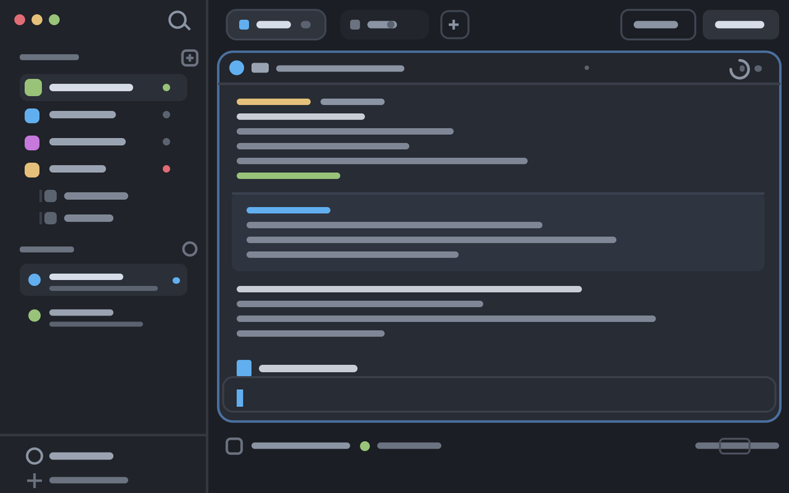

# Mayonaka

A dark, quiet Herdr workspace: a sidebar with your spaces and agents, tab pills
across the top, and every terminal as a rounded card. A panel opens on the right
with a file browser that edits files in a code pane beside the terminals, the
shipped Changes list, and a lane graph of every branch. A status bar shows the
current agent and the machine's load, and ⌘⇧P opens a command palette with the
layout's own commands on top.

## What you see

Left to right: a sidebar, then one column holding the tab bar, the terminals
(with the right panel beside them) and the status bar. There is no system title
bar; the layout draws its own, and on macOS the window buttons sit at 12, 16 px.
The window is `canvas` colored with 1px `border` lines between the sidebar and the
work area. Terminals have 14px vertical and 12px horizontal padding. Colors are
the `paper` theme in light mode and the shipped `atom-one-dark` in dark mode;
type comes from the person's settings, else Herdr's.

- **Sidebar, left, 268px** (`chrome` background; its edge can't be dragged), top
  to bottom:
  - A 46px rail that drags the window. A 26px search icon sits at its right
    edge. On macOS the rail starts 76px in, leaving room for the traffic lights;
    elsewhere it starts 14px in and the left side is empty.
  - The spaces list above the agents list, sharing the height evenly, each at
    least 90px tall.
  - A 69px footer under a 1px `border` line: *Settings* (gear icon, with a 6px
    `accent` dot after it when an app update is ready) and *Add machine* (plus
    icon, in the dimmer color). Rows are 28px tall, 13px text, 8px radius
    highlight on hover.
- **Tab bar, 42px**, `chrome` background, 1px `border` line below it; it drags the
  window. From the left: one pill per tab of the shown space, a 26px `+`, then
  three 26px panel buttons *Files*, *Changes* and *Graph* (12px text, 14px icon;
  the one whose panel is showing has a `selected` background). Where the system
  draws no window buttons (Linux, Windows) three more 26px buttons close the row:
  minimize, maximize or restore, close.
  - A pill is 29px tall with a 7px radius and 12.8px text: the 14px icon of the
    tab's agent (else its first program), the name, then the status mark. A tab
    nobody named shows its program's name, else *Terminal*; a zoomed tab gets a
    ` Z` after the name. Names stop at 170px with an ellipsis. The active pill has
    a `raised` background, a `border` outline and `foreground` text, and a
    small × after the status mark; the others are `chrome` with `muted` text.
- **Main, the rest of the height**, with 8px padding and an 8px gap around the
  cards. Each terminal or opened file is a card with the terminal's background, a
  10px radius and a 1px `border` (an `accent` border while focused), 8px apart; a
  tab's only pane is a card too. Each card has a 30px header, always visible,
  over a 1px `border` line: for a terminal, the program's 14px icon, the program's
  name in `foreground` (medium weight; an agent or shell shows its program's name,
  anything else the terminal's title), the folder in `dim` filling the rest (home
  shown as `~`), then the status mark on the right; for a file card, the file's
  14px Material icon, its file name in `foreground` (medium weight), its parent
  relative path separated by ` › ` in `dim`, a 7px `accent` dot while unsaved, and
  an eye / code toggle pair when the file has a preview. Hovering the header adds
  four 14px icon buttons on the right: split right, split down, zoom (unzoom when
  zoomed), close.
- **Right panel, 368px** (280–900 wide, closed until a panel button is pressed):
  one panel at a time, each a 10px-radius card with a `border` and the terminals'
  background.
  - *Files*: a 42px header with *Files* in semibold on the left, the folder name
    dimmed and right-aligned, and a 26px search button (`⌘⌥F`, `/` or `⌘F`, or
    typing any character when the tree is focused) that replaces the title row
    in-place with a 30px `Filter files…` input, a `.*` toggle to include
    git-ignored files, and a `×` button. Below, 28px rows: a chevron for folders,
    a full-color 16px Material Icon Theme icon (by file name, then extension, or
    the folder's name; an open folder shows its open icon), the name (with matched
    letters highlighted in `accent` during search and the parent folder in `dim`),
    a 5px dot when the file is open in an editor (`accent` when active or dirty,
    else `muted`), and a one-letter git mark on the right at 11px: `A` green
    (added or untracked), `M` yellow, `D` and `U` red. A file or folder git
    ignores shows its icon faded to 45% and its name in `dim`, with no mark, and
    so does everything under an ignored folder.
  - *Changes*: the shipped panel, unchanged.
  - *Graph*: the repository's local branches, remote branches and tags as colored
    lanes, in 24px rows: the lane graph, ref pills (`HEAD → main · origin`,
    `◆ tag`), the subject, the short SHA and the date. An *Uncommitted Changes*
    row comes first when the tree is dirty. Merges are hollow dots, HEAD is a ring.
- **Status bar, bottom, 28px**: `chrome` background, 1px `border` line above it,
  11.8px `muted` text, 14px side padding. From the left: the machine (monitor
  icon and *This computer*, or a server icon and the remote's name), the git
  branch of the shown space, then the current agent's session filling the middle
  — its program icon and its terminal title without the leading status glyph.
  The current agent is the focused one, else the latest one in the shown tab. On
  the right: `CPU 16%  MEM 77/128G` (CPU load and used memory of the machine the
  shown space lives on; memory under 10G has one decimal), then the palette hint
  in `dim`: the key bound to the palette, such as `⌘⇧P  commands`. Where the load
  can't be read (offline machine, Windows) the CPU and memory are left out.
- **Editor card** (opened from Files, tiled beside the terminals): each file gets
  its own card with no duplicate internal header when `mayonaka-pane` frames the
  layout (falling back to a compact 34px bar in other layouts). Markdown opens as
  a rendered preview, everything else as source with line numbers. An image opens
  as a picture with a 26px footer. With no file it reads *No file*.
- **Palette** (⌘⇧P or a click on the hint): a popup 640px wide, 40px from the top
  of the window. A 36px input with an `accent` outline, a magnifier at its start
  and *Esc* at its end; below it ten 32px rows with 26px group titles.
- **`+` menu**: a popup 250px wide listing *Terminal*, *Browser*, a *Start an
  agent* group of agents, then *New space*, *New worktree…* and *Open worktree…*
  in 31px rows.

## How it behaves

- **Agent status** (working, blocked, done, idle) shows like this:

  | Where | working | blocked | done | idle |
  |---|---|---|---|---|
  | Spaces and agents lists | spinner | dot in `blocked` | dot in `done` | agents list only: hollow ring in `idle`, name in `muted` |
  | Tab pill | 12px spinner in `working` | 6px dot in `blocked` | 6px dot in `done` | nothing |
  | Pane header | 12px spinner in `working` | a *Needs you* pill: 10.5px bold `blocked` text on a `blocked` tint | 7px dot in `done` | nothing |
  | Status bar | none: it shows the agent's title | none | none | none |

  The spinners on tab pills and pane headers turn once every 900ms.
- **Window**: the rail and the tab bar drag the window; double-click maximizes.
- **Rail and footer**: *Search* opens the shipped `picker`; *Settings* opens
  `app.settings`; *Add machine* opens the `machine-add` dialog.
- **Sidebar** never folds on its own: its edge isn't draggable and nothing in the
  layout shrinks it. Set under 160px (for example with `layout.resize {id:
  "sidebar", px: 76}`, which was not tried here) the rail loses its search button
  and the footer drops its labels.
- **Tabs**: a click selects; a double-click renames; dragging a pill onto another
  moves the tab there; right-click opens the shipped tab menu; the wheel over the
  bar steps through tabs; the × closes the active tab. If an agent is still
  working in it, a *Close <name>?* dialog says so first.
- **Panel buttons** show that panel for the current space and select it; pressing
  the one that is showing closes the panel. Each space remembers its own choice
  (closed if it never opened one), and ⌘⌥B does the same as the *Files* button.
  ⌘⌥F opens the Files panel and focuses its file search input.
- **Pane header**: a click focuses the pane. While a file is dragged out of
  Files, the header of the pane under the pointer turns `accent` with a `selected`
  background. Clicking `×` on an editor card header forwards `close-pane` to that
  editor so unsaved edits are flushed (when auto save is on) or warned before
  closing, and records the file in closed-file history.
- **Files**: click a folder to expand it (↑/↓/←/→/Enter navigate from the
  keyboard), click a file to open or focus its card in this tab without replacing
  any open file: if that file is already open in any editor card in this tab,
  that card is focused; otherwise the 1st file splits right of the terminal, the
  2nd splits below the 1st (`[Terminal | File 1 / File 2]`), and the 3rd & 4th
  split wide cards (`w >= 520`) right into a balanced `2×2` grid before balancing
  columns downward. ⌘-click (or ⌘-Enter in search) explicitly splits right, and
  ⌥-click (or ⌥-Enter) explicitly splits below. Search indexes up to 25,000 files
  across the repository (`git ls-files --cached --others --exclude-standard`, or
  with `--ignored` when `.*` is toggled on, falling back to `rg --files` then
  `find`, or PowerShell on Windows) and fuzzy-ranks the top 100 matches (empty
  query lists open and dirty files first). Files refresh on a 10 second timer and
  on folder changes; the tree is capped at 500 entries per folder and 5,000 in
  total. The listing leaves out `.git`, `.DS_Store`, `Thumbs.db`, `desktop.ini`
  and `._*`.
- **Right-click in Files** opens a menu: on a file *Open*, *Open to the Right*,
  *Open Below*, *Reveal in Tree* (from search results), *Open with Default App*,
  *Reveal in Finder*, *Copy Path*, *Copy Relative Path*, *Rename…*, *Delete*; on a
  folder *New File…* and *New Folder…* in place of *Open*; on the empty area below
  the tree the same for the panel's folder plus *Refresh*.
  ↑/↓, Enter and Esc work in it. Rename selects the name without its extension; an
  existing name is refused. Delete asks first and moves to the Trash on macOS
  (`trash`, else Finder); on Linux, Windows and other machines it deletes
  permanently, and says so. Clean editor cards for a deleted file close
  automatically while dirty cards stay open without auto-saving back over the
  deletion. A new file opens in a file card. Default app and Reveal are hidden in
  remote spaces.
- **Drag a file or folder** out of Files (from either the tree or search results)
  onto a terminal pane to type its path there (shell-quoted, with a trailing
  space, no Enter). Inside the tree, dropping the row on another folder row moves
  it into that folder; the panel's header or the tree's blank space moves it out
  to the panel's folder. The row that would take it lights up and the label says
  where it goes (`→ docs`), the folder it lands in opens, and the tree refreshes.
  A name already taken there is refused in a toast, and a folder cannot go into
  itself or below itself. Editor cards showing the file that moved or was renamed,
  or a file under a folder that moved, follow it with their unsaved edits. Over a
  terminal, the target pane's header lights up in `accent` instead, and the drop
  types the path (through the clipboard, which gets its text back right after).
  Esc or a drop anywhere else cancels.
- **Editor**: each editor card holds a single file (`focusable: true` so
  `⌘⌥←/→/↑/↓` and `⌘⌥⇧←/→/↑/↓` navigate and swap terminal and file cards alike),
  persisted across restarts in `shared("mayonaka-editor.files")[id]`. Press ⌘W or
  the card header `×` to close the file card, and ⌘⇧T (or *Reopen closed file* in
  the palette) to reopen up to 10 recently closed files. When auto save is on,
  closing a dirty card flushes it to disk first; when auto save is off or a save
  was refused, closing shows an *Unsaved changes* warning toast on the first
  attempt and discards if repeated within 5 seconds.
  The eye / code buttons in the card header switch markdown and SVG between
  preview and source (markdown over 256 KiB opens in source first).
  The preview is editable one block at a time (a list one item at a time, nested
  items included), and stays rendered while you type: heading, quote, list and
  task markers show as a heading badge, quote bars, bullets, numbers and boxes;
  bold, italic, strikethrough, inline code, links and images show as such the
  moment their closing mark is typed. Click a mark to see and edit its markdown
  (it folds again once you type elsewhere), click a task box to tick it,
  Backspace after a marker turns the line back into text. Return in a list or
  quote starts the next item, Return on an empty item ends it. Code blocks,
  tables and front matter edit as source. A press outside the block, `Esc`, a
  save or a mode switch writes it back. A blank line typed inside a block splits
  it, an emptied block disappears, and clicking below the last block adds a new
  one. Undo works inside the open block only. Hard line breaks in the file stay
  line breaks while a block is open. An edit is saved after the last one (500 ms
  up to 256 KiB, 1.5 s up to 2 MiB, 3 s past that),
  in source and in the block being typed in alike (the block stays open), and
  every further edit pushes that back; ⌘S saves at once. *Turn auto save off* in
  the palette stops the timer in every editor until *Turn auto save on*, ⌘S still
  saves, and the choice survives a restart. A save that does not go through (the
  file changed on disk since it was opened, a write error) shows a *Not saved*
  toast and leaves the dot on; the timer stays quiet about the same failure
  after that, and ⌘S says it again. ⌘⇧V switches preview and source;
  paste and undo are the editor's own. Brace folding is turned off past 512 KiB,
  and syntax highlighting is skipped when a line exceeds 10,000 characters. Files
  over 8 MiB and binaries are refused.
  In a space on another machine the file is edited the same way and saved on that
  machine; the pane doesn't watch a remote folder, so a file changed there
  since it was opened is only noticed when saving, and that save is refused with a
  *Not saved* toast.
  **Images** (png, jpg, gif, webp, bmp, ico, tiff, svg) open as a picture fitted
  to the pane, never scaled up, with its size, file size and zoom in the footer;
  svg also has the eye / code switch to edit its source. Images are previewed up
  to 32 MiB, 6 MiB from another machine.
- **Graph**: click a commit to see its full message, author, date, parents and
  changed files in a card, always 420px wide, that floats to the left of the
  panel with its top level with that row, over the pane beside it (the list keeps
  its size and stays uncovered; the card scrolls past 340px); click the commit
  again, or press anywhere outside the card, to close it. Clicking the
  *Uncommitted Changes* row offers *Open in Changes*. It follows the focused
  pane's repository like Changes, shows the newest 600 commits (`--date-order`),
  draws at most 12 lanes (further ones are cut off), and refreshes on folder
  changes and every 15 seconds. It never writes to the repository.
- **Palette**: empty, it lists *Recent* (the last five entries run), then the
  groups *Mayonaka*, *Tab*, *Pane*, *Space*, *Layout*, *Terminal*, *Agent*,
  *Window* (not on macOS), *App*. Typing ranks entries fuzzily — your letters in
  order, word starts and runs scoring higher — and shows each entry's group at its
  right. A bound key shows as chips at the row's end. ↑/↓ and PageUp/PageDown move,
  Enter runs, Esc closes. The *Mayonaka* group holds *Toggle Files panel*, *Find
  file in Files panel*, *Toggle Changes panel*, *Toggle Graph panel*, *Reopen
  closed file* (when closed history is non-empty); *Save file*, *Toggle preview*,
  *Close file card* and *Turn auto save off* (*on* while it is off) when the
  focused tab has at least one editor card; and, when
  terminal-browser is installed here and the focused space is on this computer,
  *Open browser to the right* and *Open browser in a new tab*.
- **`+` menu**: *Terminal* starts a shell tab. *Browser* starts a tab named
  *Browser* running `terminal-browser`; while the check for it runs the row is
  dimmed, and without it the row stays dimmed and reads *not installed*. In a space
  on another machine there is no *Browser* row. *Start an agent* lists the
  installed agents, then up to two that are not installed, dimmed; digits 1–9 start
  the nth installed one. *New space* runs `space.new`; the two worktree rows open
  the shipped `worktree` dialog. Esc closes it.
- **Keys**: ⌘⌥B toggles the Files panel, ⌘⌥F searches files in the Files panel,
  ⌘⇧P opens the palette, and in the editor ⌘S saves, ⌘⇧V switches preview and
  source, ⌘W closes the file card, and ⌘⇧T reopens the last closed file.

## Built from

- `layouts/mayonaka.json`: root `row` with `theme: { light: "paper", dark:
  "atom-one-dark" }`, `preview: "layouts/mayonaka.svg"` (the 320×200 drawing
  Settings shows for the layout), `titlebar: "none"`, `traffic_lights: [12, 16]`,
  `terminal_padding: [14, 12]`, `background: canvas` and a 1px `border` divider.
  Children:
  - `sidebar`: column, 268px, min 44, max 480, `resizable: false`,
    `background: chrome`, holding `brand` (`mayonaka-chrome`, 46px,
    `window_drag`), `sidebar-lists` (a column of `spaces` and `agents`, each
    weight 1, min 90) and `sidebar-footer` (`mayonaka-chrome` with `props.footer:
    true`, 69px).
  - `work`: column, `resizable: false`, holding `tabs` (`mayonaka-tabs`, 42px,
    `window_drag`), `work-body` and `status` (`mayonaka-status`, 28px).
  - `work-body`: row, padding 8, gap 8, holding `main`, the `tab: "active"` block
    whose `pane` frame is `{ header: { content: { mod: "mayonaka-pane" }, reveal:
    "always", height: 30, position: "top" }, background: "background", border: 1px
    border, focus: 1px accent, radius: 10, gap: 8, lone: true }`, and `panel`: a
    column, 368px, min 280, max 900, `hidden: true`, holding the `panel-body`
    stack (active `files`) whose children are blocks `files`
    (`mayonaka-files`), `changes` (the shipped `changes`) and `gitgraph`
    (`mayonaka-gitgraph`).
- `mods/mayonaka-chrome/`: a clone of the shipped `workspace-chrome` (0.1.13),
  used twice: without `props.footer` the rail (`mods/mayonaka-chrome/*.svg`
  icons, `run("mod.open", {name: "picker"})`), with it the two footer rows
  (`run("app.settings")`, `run("mod.open", {name: "machine-add"})`, and
  `updates().app.ready` for the dot). It reads `layout()` for the `sidebar` node's
  width and draws its compact form under 160px. It still carries the shipped
  `toggleSidebar()` (`layout.resize` + `shared("sidebar.width")`), which nothing in
  this layout calls.
- `mods/mayonaka-pane/`: a `mod.clone` of the shipped `pane` header, 12px text,
  with its own `split-right`, `split-down`, `zoom`, `unzoom` and `close` icons,
  the spinner of `workspace-chrome`, and `material.js` so editor cards show the
  file's 14px Material icon, file name, parent relative path (`mods › …`), dirty
  dot and preview/source toggle (`mayonaka-editor.set-mode`) from
  `shared("mayonaka-editor.files")`. It reads `panes()` for its pane
  (`props().pane`) and runs `pane.focus`, `pane.split {direction, pane}`,
  `pane.zoom {pane}`, `pane.close {pane}` (or sets
  `shared("mayonaka-editor.target")` and runs `mayonaka-editor.close-pane` for
  editor cards). Herdr gives mods no pane geometry, so on every press
  (`on_mouse_down_out` carries the element's `bounds`) each header writes where it
  is to `shared("mayonaka-pane.rects")`; `mayonaka-files` uses these rectangles
  both for drag targets and for smart card tiling.
- `mods/mayonaka-tabs/`: a `mod.clone` of the shipped `tabs` with four changes.
  The *Graph* button is shown when the layout's `panel-body` has a `gitgraph`
  child (the other two follow `shared("workspace.panels")`, default `["files",
  "changes"]`). The `+` opens `mayonaka-new-menu` as a 250×543 popup in place of
  `new-menu`. `nextCommand()` handles `files-search` (selecting and showing the
  Files panel and setting `shared("mayonaka-files.search")`), `reopen-file`
  (popping `shared("mayonaka-editor.closed")` and tiling or focusing the restored
  file card), and panel ids (`layout.select` + `layout.show`, or `layout.hide`
  when that panel already shows); the per-space choice is kept in `localStorage`.
  Pills use `tab.select`, `tab.rename`, `tab.move`, `tab.prev` / `tab.next`, the
  shipped `menu` for right-click and the shipped `confirm` dialog for a working
  agent; window buttons use `window.minimize`, `window.maximize`, `window.close`.
- `mods/mayonaka-files/`: a clone of the shipped `files` (0.1.13), `focusable:
  true`, extended with smart card tiling and deep fuzzy search: `panes()` and
  `shared("mayonaka-pane.rects")` to focus already-open file cards or tile new
  cards into a balanced stack/grid (`shared("mayonaka-editor.ids")`,
  `shared("mayonaka-editor.files")`, `shared("mayonaka-editor.last")`,
  `shared("mayonaka-editor.open")` and `run("pane.split", {mod:
  "mayonaka-editor", ...})`). Search (`Input` / `InputState` from `gpui-base`,
  `search.svg`) indexes up to 25,000 relative paths via `git ls-files` (falling
  back to `rg --files` or `find`, or PowerShell on Windows) and renders up to 100
  fuzzy-ranked rows in an `overflow_y_scroll` list so right-click menus and
  drag-to-terminal work identically to the tree. The tree listing is the shipped
  code (`exec("sh", ...)` or PowerShell, `watchFolder`, `readTextFile`), with
  `location()` as a cold-start fallback. Git marks come from `exec("git",
  [..."status", "--porcelain=v1", "-z", "--no-renames", "--untracked-files=all",
  "--ignored=matching"])` on the pane's machine with `--no-optional-locks` and
  `core.fsmonitor=false`, so the refresh writes nothing under `.git`; `!!`
  entries are the ignored set, and a row is faded when it or any folder above it,
  up to the repository root, is in it. Its art: `material/`, 242 SVGs from
  material-icon-theme 5.40.0 (MIT, `material/LICENSE`), drawn with `image()`;
  `material.js` holds the file-name, extension and folder-name lookups (an exact
  name first, then the longest dotted suffix; an open folder is its icon +
  `-open`). `tools/material-icons.py` generates `material/` and writes
  `material.js` into `mayonaka-files`, `mayonaka-editor` and `mayonaka-pane`.
- `mods/mayonaka-editor/`: the single-file card editor (`focusable: true`), with
  no duplicate internal header when `mayonaka-pane` frames the pane. Each card
  holds its own `EditorState`, markdown block edit state, image metadata, SHA-1
  digest and save/dirty timers; `shared("mayonaka-editor.files")[id]` stores
  `{file, on, root, mode, dirty, hasPreview}`, and closed cards append to
  `shared("mayonaka-editor.closed")`. `EditorState` /
  `Editor` and `TextView.markdown` come from `gpui-base`, one `TextView.markdown`
  per block of `blocks.js` (a line-based splitter that keeps each block's source
  offsets) and a `TextareaState` for the block being edited, closed by
  `on_mouse_down_out`. In it `inline.js` turns markers and inline marks into
  `.token(...)` spans with `replace_range_with_token` (never `set_value`, which
  lands a frame late and would drop keystrokes) and `on_token_click` opens or
  ticks them. `image.js` draws pictures. `readTextFile` / `writeTextFile` with
  the expected text up to their 1 MiB cap, `watchFolder` to reload clean cards on
  outside changes (with a `wc -c` size gate and SHA-1 digest check so a card's
  own saves skip decoding a multi-megabyte string again), `nextCommand()` routed
  to the focused or explicitly targeted editor card
  (`shared("mayonaka-editor.target")` / `mayonaka-editor.last`), and `notify` for
  refused saves or unsaved-close warnings. Keystrokes mark the card dirty
  optimistically without copying the buffer across FFI; `save()`, `closePane()`
  and an 800 ms idle check (when auto save is off) verify against `original`. The
  auto save is a `cx.timer.after(delay, …)` (500 ms up to 256 KiB, 1,500 ms up to
  2 MiB, 3,000 ms past that) that every edit cancels and sets again; its handler
  starts the save in `cx.spawn`. On and off are two commands that set
  `shared("mayonaka-editor.autosave")` (on unless it is `false`). `remote.js`
  reads and saves past `herdr`'s limits (up to 8 MiB, `exec`'s output cap): files
  over 1 MiB are read with `fs` under home or `cat` through `sh` elsewhere, and
  saves over 1 MiB or on another machine check the file on disk first (by digest
  here, by text remotely), refuse unless it still matches what the card opened,
  write the new text to a per-save staging file
  `cache/mayonaka-editor/save/<id>-<seq>.txt` under the app's home, run
  `hc file write` (`--on <machine>` when remote) through `sh`, check that the
  `bytes` it answers with equal the text's UTF-8 length, and delete the copy.
  `hc file write` keeps the file's mode, follows a symlink and replaces
  atomically.
- `mods/mayonaka-files-menu/`: the popup menu for `mayonaka-files`, opened with
  `openOverlay({kind: "popup"})` and the rows built in `props.items`; it reopens
  itself as a `dialog` for the name (`InputState`) and delete steps. It only asks:
  the choice goes back on `props.replyKey ?? "mayonaka-files.action"` and the
  caller does the work with `exec` (`sh`, or PowerShell on Windows),
  `cx.write_to_clipboard` and `notify`.
- `mods/mayonaka-files-drag/`: the drag. A transparent `kind: "window"`,
  `frame: "none"` overlay over the whole window, opened when a pressed row moves
  6px, takes the rest of the gesture. `target.js` (pure geometry, no Herdr imports)
  turns props `{ path, dir, parent, cols, rowH, first, last, folders, header,
  tree }` into the drop under the pointer: a folder row's 28px band, the panel's
  header, or the tree's blank space. Those come from the pressed row's own
  `bounds` (rows are a flat list of one height, so its index places every row)
  plus the header rectangle the panel records on `on_mouse_down_out` and the tree
  height from `on_size_change`. The panel sets `shared("mayonaka-files.drag")` for
  the gesture so its 10-second refresh never moves a row under the pointer; the
  overlay clears it on release. On release it posts `{action: "move", to}` (the
  panel runs `mv` with an existence guard, then posts
  `shared("mayonaka-editor.moved")` `{from, to, on}` for the editor panes) or
  `{action: "drop", pane}` (the panel runs `cx.write_to_clipboard`, `pane.focus`
  and `terminal.paste`, then restores the clipboard).
- `mods/mayonaka-gitgraph/`: `exec("git", ["log", "--branches", "--remotes",
  "--tags", "HEAD", "--date-order", "-n", "600", ...])` with the same no-lock read
  flags as Changes, plus `status` and `remote`. Lanes are laid out in JS and drawn
  per row with `window.paint_path(PathBuilder.stroke(1.5)...)` layers;
  `v_virtual_list` keeps only the visible rows built; `watchFolder` and a 15 s
  timer trigger refreshes. The detail card is a `Popup` (`gpui-base`) built in
  `render()`, never in the row renderer, where a handler throws and the list draws
  nothing: `anchor("top_right")` pins its top right corner to a 1px trigger on the
  list's left edge, at the pressed y, which the list container's `on_mouse_down`
  recorded as `local_position` because `on_item_click` hands over only the hash; an
  8px right padding is the gap to the panel. A `Popup` has no dismissal of its own,
  so the card's `on_mouse_down_out` closes it, and a press on the card stops
  propagating so it never reaches the rows underneath. Its icon is `git-graph.svg`.
- `mods/mayonaka-status/`: the status bar. `spaces()` for the machine and branch,
  `agents()` and `focused()` for the current agent (its `program.icon` and its
  title with the leading status glyph stripped), `keys()` for the palette hint (the
  `mod.open:mayonaka-palette` binding in `global`, else `app.palette`'s),
  `run("mod.open", {name: "mayonaka-palette"})` on click. CPU and memory come from
  `exec("sh", ["-c", …], { on: machine, timeout: 10000 })`: `iostat`, `vm_stat` and
  `sysctl` on macOS (memory counted as Activity Monitor does: app + wired +
  compressed, no file cache), `/proc/stat` and `/proc/meminfo` on Linux
  (`MemAvailable`), sampled over a second and refreshed every 5 seconds, one sample
  at a time per machine. Its three icons (`monitor`, `server`, `branch`) are its
  own.
- `mods/mayonaka-new-menu/`: a `mod.clone` of the shipped `new-menu` (0.1.15), the
  popup behind the `+`, with a *Browser* row under *Terminal*: `tab.new {name:
  "Browser", argv: ["terminal-browser"]}`, drawn with its own `globe.svg`.
  `exec("sh", ["-c", "command -v terminal-browser"])` decides whether the row is
  enabled; it runs here, so in a space on this computer it decides the row, and in
  a space on another machine the row is left out, since the check and the tab would
  be on different machines. The row makes the list 31px taller, so the inner height
  caps at 522 instead of 491.
  Everything else is the shipped menu's: `knownAgents()`, `tab.new`, `space.new`
  and the shipped `worktree` dialog, `icons/shell.svg`, `mods/workspace-chrome/branch.svg`.
- `mods/mayonaka-palette/`: Herdr's own palette (`frame/palette`) copied, with a
  *Mayonaka* group after *Recent*. The app's palette lists `commands()`, which
  leaves out a mod's `<mod>.<command>`, so those can only be added in a copy. The
  group holds `mayonaka-tabs.<id>` for each child of the layout's `panel-body`
  stack (*Toggle Files / Changes / Graph panel*, from `layout()`),
  `mayonaka-tabs.files-search` (*Find file in Files panel*),
  `mayonaka-tabs.reopen-file` (*Reopen closed file*, when
  `shared("mayonaka-editor.closed")` is non-empty), and
  `mayonaka-editor.save` / `.toggle` / `.close-pane` and `.autosave-off`
  (`.autosave-on` while `shared("mayonaka-editor.autosave")` is `false`) whenever
  `panes()` shows at least one editor in the focused tab (setting
  `shared("mayonaka-editor.target")` before dispatching so multi-card tabs target
  only the focused or most recently used editor card); and, when `command -v
  terminal-browser` succeeds and the focused space is on this computer,
  `pane.split {direction: "right", argv: ["terminal-browser"]}` and `tab.new
  {name: "Browser", argv: ["terminal-browser"]}`. Every other entry is the app's:
  the `NAMED` titles, one *Layout:* entry per `layouts()`, and whatever new
  command `commands()` reports (minus `HIDDEN`). A key hint comes from `keys()`,
  looking in `global` and in the entry's own `mod:<name>` section; an entry with
  more than one argument has none. The last twenty entries run are kept in
  `localStorage`. *Duplicate mod* opens the shipped `prompt` dialog. `mod.json`
  gives the popup its overlay: `{ kind: "popup", at: "top", offset: 40, width:
  640, height: 408 }`; `search.svg` is its own.
- `keys.json`: `global`: `cmd-alt-b` toggles the Files panel
  (`mayonaka-tabs.files`), `cmd-alt-f` searches files in the Files panel
  (`mayonaka-tabs.files-search`), `cmd-shift-p` opens `mayonaka-palette` in place
  of the app's `app.palette`; `mod:mayonaka-files`: `cmd-f` starts file search,
  `cmd-shift-t` reopens a closed file; `mod:mayonaka-editor`: `cmd-s` save,
  `cmd-shift-v` preview toggle, `cmd-w` close file card, `cmd-shift-t` reopen
  closed file. Merge into yours; don't replace keys you already use.
- Shipped mods it uses: `spaces`, `agents` and `changes` as blocks; `picker`,
  `machine-add`, `menu`, `confirm`, `worktree` and `prompt` opened by name; `toast`
  through `notify`; and icons only from `files`, `changes`, `pane`,
  `workspace-chrome` and the app's `icons/`.

## Watch out

- The mods carry no `gpui-kit.d.ts` / `jsconfig.json`: Herdr writes those on first
  load.
- `mayonaka-files`, `mayonaka-pane`, `mayonaka-tabs` and `mayonaka-editor` talk
  through the shared keys `mayonaka-editor.ids` / `.files` / `.open` / `.last` /
  `.target` / `.closed` / `.moved` / `.deleted`. Rename one side and they stop
  following each other.
- `image()` only loads files under `~/.config/herdr-app` (not absolute paths, not
  symlinks out of it), so the editor copies an image to
  `~/.config/herdr-app/cache/mayonaka-editor/<editor id>-<sha1>.<ext>`
  and removes it when the card closes or unmounts (plus sweeps stale files for
  dead editor ids on startup). `fs` reads only under the home folder; images
  elsewhere come through `exec("sh", ["-c", "base64 < …"])`, whose output is
  capped at 8 MiB (hence the 6 MiB limit for remote images).
- `mayonaka-files` opens `mayonaka-files-menu` and `mayonaka-files-drag` by name:
  clone or rename one and change the others.
- A drop inside the tree reads row positions from the pressed row's `bounds` and
  the header / tree rectangles recorded by the last press elsewhere, so those get
  checked against each other first. When they don't line up (another layout, a
  stale rectangle) `target.js` is handed no folders and a drop falls back to the
  terminal behaviour.
- A move is `sh` + `mv` on the pane's machine, or PowerShell's `Move-Item` on
  Windows. It refuses an existing name; it does not ask first, and there is no
  undo beyond the shell's own.
- Ignored files are only known inside a git repository, from one `git status
  --ignored=matching` per refresh: git names an ignored folder once, so its
  contents are never listed by git and the panel infers them from the folder.
  Outside a repository nothing is faded and there are no marks.
- `mayonaka-editor` writes only the file you opened. On another machine, and for
  files over 1 MiB here, that goes through `hc file write` (`--on <machine>` when
  remote), so `hc` must be on the PATH `exec` sees and that machine's core must
  have `hc file` (tried on a 0.1.17 core); `sh` is needed here too (Windows, not
  tried here). The pane compares the file with what it opened just before writing:
  that is a check, not a lock, and someone else's write in those few milliseconds
  can still be overwritten.
- Auto save writes the file at every typing pause (0.5–3 s depending on file
  size), so anything watching that folder (a dev server, a test runner, a
  formatter) sees a half-typed file, and an agent changing the file in the
  meantime makes the next save refuse. Closing a dirty card through `⌘W` or the
  card header `×` flushes it first when auto save is on, whereas quitting the app
  cancels pending timers without flushing since the host only promises to finish
  some calls at quit.
- `mayonaka-chrome` reads the node id `sidebar`: a different layout with no
  `sidebar` node keeps it wide.
- `mayonaka-tabs` opens `mayonaka-new-menu` by name and sizes its popup for it
  (543px high): clone or rename one and change the other. The copy keeps the
  shipped menu's shared key `new-menu.agents` for its list of agents.
- `mayonaka-palette` is a copy: when Herdr changes its palette, this one keeps the
  old look and the old `NAMED` titles. New commands still show up, through the
  `commands()` loop. `<mod>.<command>` reaches every shown copy, so
  `mayonaka-editor` checks that it owns the focused pane or matches
  `shared("mayonaka-editor.target")` before acting. Rebind `cmd-shift-p` to
  `app.palette` to go back to the app's. Because *Recent* comes first, *Mayonaka*
  is the first group only until something has been run.
- The browser entries start terminal-browser as the pane's own program, because
  Herdr sets `TERM_PROGRAM=ghostty` and terminal-browser then scripts Ghostty for
  anything it asks of the terminal: `terminal-browser ls` answers "Ghostty is not
  running, so there is no window to script". `--split`, `new-tab` and sending a
  page to an agent use the same scripting and were not tried. On a cold start the
  pane was still empty about 30 seconds in and had drawn the page after a minute.
- The rail reserves room for the macOS traffic lights; on Linux and Windows the
  layout draws nothing there, so the rail starts 14px in with an empty left side.
- The panel is closed in the shipped layout (`"hidden": true`). Opening it is a
  panel button's job.
- The CPU / memory read runs `sh` on the machine of the shown space, and the
  terminal-browser check runs `sh` on this computer. Without `sh` (Windows, not
  tried here) the load is left out, the *Browser* row reads *not installed* and
  the palette offers no browser entries.
- `preview.png` is a drawing of the layout, not a screenshot of a running app.

## Done when

- `herdr-app check` passes for each of the eleven folders under `mods/`.
- With `layout.switch {name: "mayonaka"}`, the window shows the rail, the lists,
  the tab bar, the card-framed terminals with their 30px headers and the status
  bar, and `herdr-app status` reports no `errors`.
- Hovering a pane header shows four buttons (split right, split down, zoom, close);
  with an agent working, its pane header and tab pill show a spinner, and a
  blocked one shows *Needs you* in the header and a dot on the pill.
- Closing the active tab with a × while its agent is working asks first; with
  nothing running it closes at once.
- The Files button opens a 368px panel listing the focused pane's folder; pressing
  it again closes it; ⌘⌥B does the same; ⌘⌥F opens it with the fuzzy file search
  focused; switching to another space and back restores that space's choice.
- In a repository whose `.gitignore` lists `node_modules`, that folder's row (and
  anything inside it once opened) is faded with no mark; a modified file shows a
  yellow `M`, a new one a green `A`.
- Clicking a file in the Files panel splits a file card to the right of the
  terminal; clicking a second file stacks a second file card below the first, and
  clicking a third and fourth file tiles them into a `2×2` card grid without
  evicting anything; clicking an already open file focuses its card, ⌘W closes
  the focused file card and ⌘⇧T reopens it; typing in a file and stopping writes
  it shortly after with no key pressed, and the dot disappears; ⌘S writes it at
  once.
- With *Turn auto save off* chosen in the palette an edit stays unsaved (dot on)
  until ⌘S, and the palette then offers *Turn auto save on*.
- In a space on another machine the same holds: paste text into a block of a
  markdown file there and wait half a second (or press ⌘S), and the dot disappears
  and the file on that machine has the text; if the file was changed there first, a
  *Not saved* toast says so, once however much you go on typing, and nothing is
  written.
- Dragging a row onto a folder row moves it in and the tree shows it there;
  dragging it onto the panel's header moves it out to the panel's folder; dragging
  it onto a terminal (from the tree or from search results) still types its path.
- The Graph button opens a lane graph of the focused pane's repository; clicking a
  commit lists its changed files in a 420px card left of the panel.
- ⌘⇧P (and a click on the hint at the status bar's right end, which reads
  `⌘⇧P  commands`) opens a palette whose *Mayonaka* group comes right after
  *Recent*; choosing *Toggle Graph panel* there shows or hides the Graph panel like
  its button.
- The `+` in the tab bar lists *Browser* under *Terminal*; with terminal-browser
  installed, choosing it opens a tab named Browser that runs it, and without it the
  row is dimmed and reads *not installed*.
- With terminal-browser installed, *Open browser to the right* in the palette splits
  a pane beside the focused one that draws the browser's start page.
